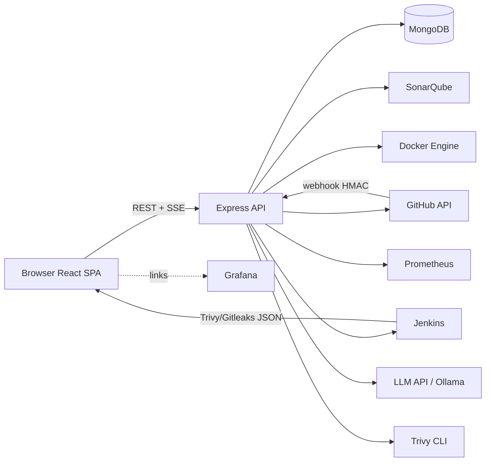
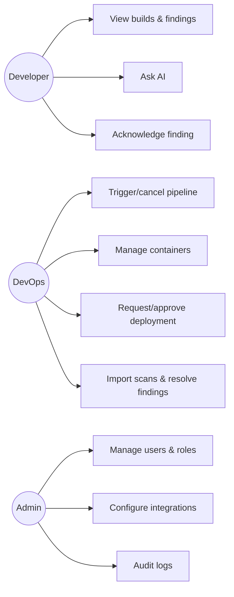
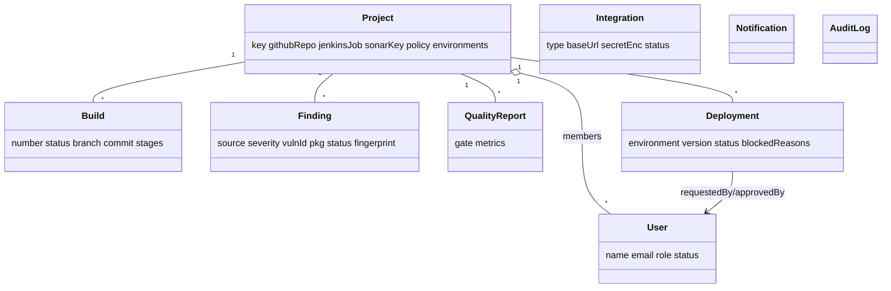
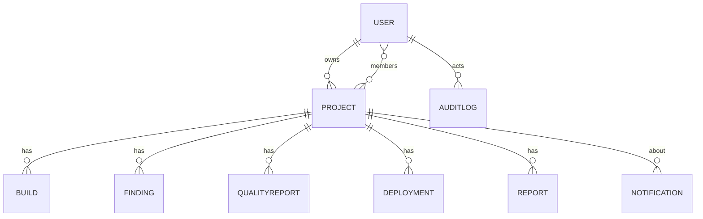
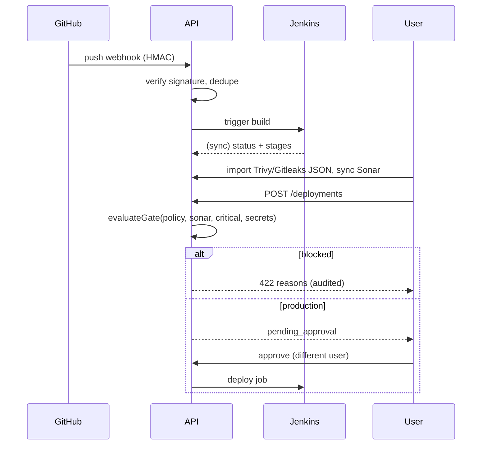
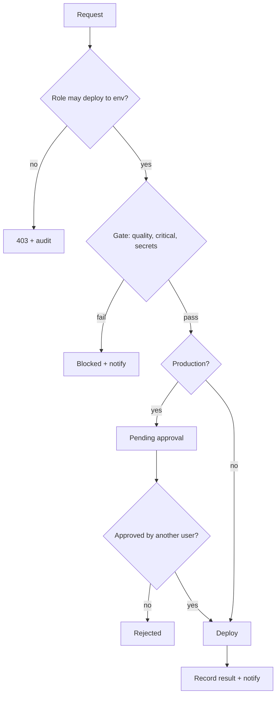

# Software Engineering Documentation

## 1. Software Requirements Specification (summary)
**Purpose**: one web application to manage the secure software delivery lifecycle. **Users**: Administrator, DevOps Engineer, Developer. **Stack**: React/Vite/Tailwind, Express, MongoDB.

### Functional requirements
| ID | Requirement |
|---|---|
| FR-1 | Register/login, JWT sessions, password reset, account lockout after 5 failures, profile, logout |
| FR-2 | RBAC with 3 roles enforced server-side; project-scoped data access |
| FR-3 | Project CRUD/archive, members, environments, policies, GitHub/Jenkins/Sonar association |
| FR-4 | GitHub repo browsing, commits, PRs, branches; signed, idempotent webhooks |
| FR-5 | Jenkins job sync, trigger, cancel, stages, logs, history |
| FR-6 | SonarQube gate + metrics sync, history |
| FR-7 | Trivy and Gitleaks import (and Trivy image scan), finding lifecycle, masking |
| FR-8 | Docker containers/images, details, logs, start/stop/restart |
| FR-9 | Deployment request, policy gate, approval, result, rollback |
| FR-10 | Prometheus metrics, targets, alerts, Grafana links |
| FR-11 | AI assistant grounded in logs/findings |
| FR-12 | Notifications (SSE live), preferences |
| FR-13 | PDF reports with history |
| FR-14 | Append-only audit log |
| FR-15 | Team management, integration management with credential rotation |
### Non-functional requirements
Security (OWASP: bcrypt-12, helmet, rate limiting, zod validation, AES-GCM secrets, HMAC webhooks, no shell execution with user input), Performance (indexed queries, paged lists), Reliability (idempotent webhooks, guarded background jobs), Usability (responsive, dark/light, keyboard focus, skeleton/empty/error states), Maintainability (modular routes/services, pure policy functions with unit tests), Observability (audit + activity feed).

## 2. System architecture

## 3. Use cases

## 4. Class diagram (domain)

## 5. ERD

Indexes: `Build(project,number)` unique, `Finding(project,fingerprint)` unique, `User.email` unique, `WebhookDelivery.deliveryId` unique (TTL 7d).

## 6. Sequence: push -> pipeline -> gate -> deploy

## 7. Activity diagram: deployment eligibility

## 8. API documentation (all under `/api`, JWT Bearer)
| Area | Endpoints |
|---|---|
| Auth | `POST auth/register, login, logout, forgot, reset, password` · `GET/PATCH auth/me` |
| Users (admin) | `GET users` · `POST users/invite` · `PATCH users/:id` · `GET users/lookup` |
| Projects | `GET/POST projects` · `GET/PATCH projects/:id` |
| Integrations | `GET integrations` · `PUT integrations/:type` · `POST :type/test, :type/rotate` · `DELETE :type` |
| GitHub | `GET github/repos`, `github/repos/:owner/:repo` · `POST github/webhook` |
| CI/CD | `GET cicd/jenkins/jobs`, `cicd/builds`, `cicd/builds/:id[/log]` · `POST cicd/jenkins/projects/:id/sync,trigger` · `POST cicd/builds/:id/cancel` |
| Quality | `GET cicd/quality`, `cicd/quality/:projectId/history` · `POST cicd/quality/:projectId/sync` |
| Security | `GET security/findings` · `PATCH security/findings/:id` · `POST security/import/trivy, import/gitleaks, scan/trivy` |
| Docker | `GET docker/containers, images, containers/:id` · `POST docker/containers/:id/(start|stop|restart)` |
| Deployments | `GET/POST deployments` · `POST :id/approve, reject, result, rollback` |
| Monitoring | `GET monitoring/metrics/:name?range=1h, targets, alerts, links` |
| AI | `POST ai/chat` |
| Dashboard | `GET dashboard/summary, series, security, activity, health, search` |
| Reports | `POST reports` · `GET reports` · `GET reports/:id/download` |
| Notifications | `GET notifications` · `POST notifications/read-all, :id/read` · `GET events` (SSE) |
| Audit (admin) | `GET audit` |

## 9. Test plan and results
| Level | Scope | Status |
|---|---|---|
| Unit | encryption round-trip/tamper, redaction, masking, audit-meta scrubbing, gate policy, Trivy/Gitleaks normalisation | **7/7 passing** (`cd backend && npm test`) |
| Build | frontend production build (`npm run build`) | passing |
| Integration (manual checklist) | register->admin; create project; configure each integration and press Test; webhook (use GitHub "Redeliver" to verify duplicate handling); import sample Trivy JSON; request deploy and verify block/approval; generate PDF | to run in your environment (needs live tools) |
| Security (manual checklist) | developer cannot call admin/devops endpoints (expect 403); developer cannot see other projects; webhook with bad signature -> 401; audit log has no tokens; integration GET never returns secrets; login lockout | to run in your environment |

## 10. Deployment
Single node: MongoDB + `npm run build` + `npm start` in `backend` (serves the SPA) behind an HTTPS reverse proxy (nginx/Caddy). Set strong values in `.env`; restrict Mongo to localhost; mount the Docker socket only if Docker management is wanted (it is root-equivalent: prefer a socket proxy limited to container list/inspect/start/stop/restart).

## 11. User manual (short)
1. Sign in. Admin: **Integrations** -> configure and test each tool. 2. **Projects** -> New project, link repo/job/Sonar key, add members, set policies. 3. **Pipelines** -> Sync/Run; open a build for stages and logs. 4. **Security Center** -> import Trivy/Gitleaks JSON; acknowledge/resolve with a note. 5. **Deployments** -> request; production requires approval from another DevOps/Admin. 6. **AI** -> use "Ask AI" on a build or finding. 7. **Reports** -> choose project and dates, generate and download the PDF. 8. **Audit Logs / Team** (admin only).
